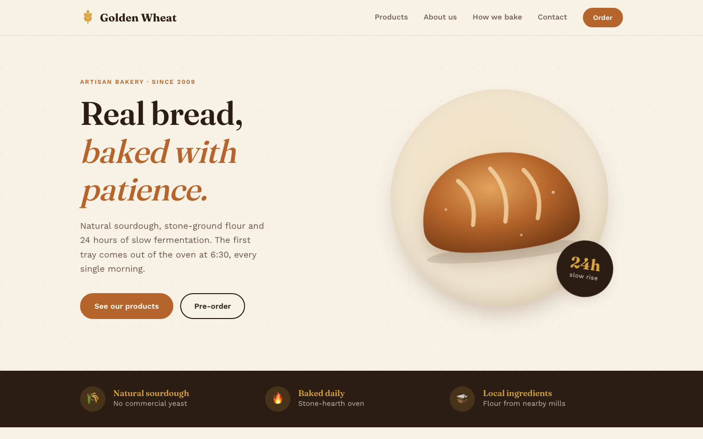
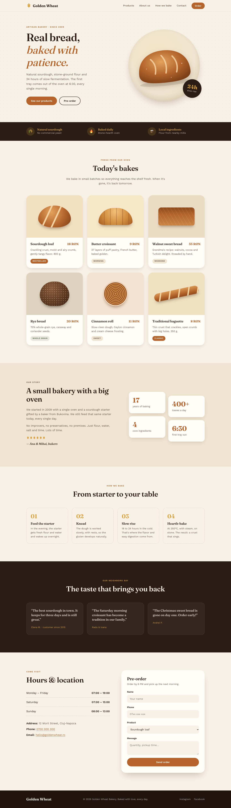
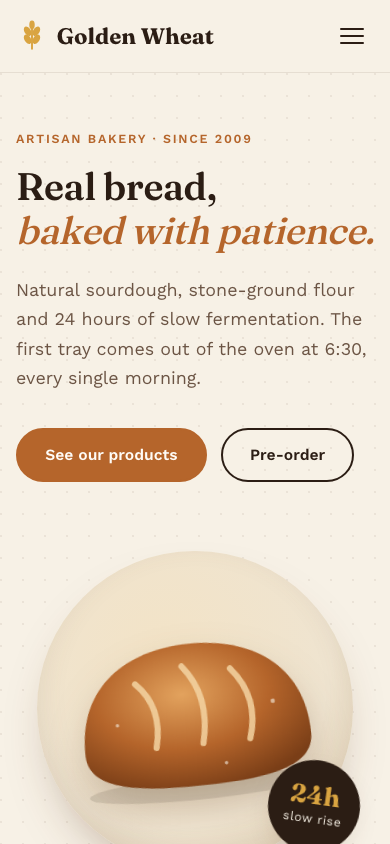

# Golden Wheat Bakery — Design

## Concept
A neighborhood artisan bakery: sourdough bread baked every morning in a stone-hearth oven.
The visual tone is **warm, calm and handcrafted**, like kraft paper, flour and a golden crust.
There are no stock photos. The illustrations are built with SVG and CSS, so the site loads fast and looks consistent.

## Color palette
| Role | Name | Hex |
|---|---|---|
| Main background | Flour | `#F7F1E6` |
| Secondary background | Dough | `#EFE4D0` |
| Main text | Espresso | `#2B1D14` |
| Secondary text | Bark | `#6B5444` |
| Primary accent | Crust | `#B5652B` |
| Secondary accent | Wheat | `#D9A441` |
| Cool accent | Sage | `#7A8B6F` |

Rule: the Crust accent is used only for buttons, links and prices, so it draws the eye there.

## Typography
- **Headings:** Fraunces, weight 600. A serif with character that recalls old printed labels.
- **Body:** Work Sans, 400 / 500, 17px base size, 1.65 line height.
- **Small labels:** Work Sans, uppercase, 0.14em letter spacing.

## Visual elements
- Generous rounded corners (18–28px), like a loaf of bread.
- Soft brown shadows instead of gray ones.
- Wheat-ear dividers.
- Subtle "flour dust" texture (radial dots) behind the hero section.

## Page structure
1. **Header:** logo, menu (Products, About us, How we bake, Contact), "Order" button
2. **Hero:** large headline, subtitle, two buttons, SVG bread illustration
3. **Perks strip:** natural sourdough · baked daily · local ingredients
4. **Products:** grid of 6 cards (illustration, name, description, price)
5. **About us:** our story plus a few stats
6. **How we bake:** 4 steps, from starter to oven
7. **Testimonials:** 3 quotes
8. **Hours & contact:** opening hours, address and a pre-order form
9. **Footer**

## Responsive
- Desktop ≥ 960px: 3-column grids, 2-column hero
- Tablet 640–960px: 2 columns
- Mobile < 640px: single column, CSS-only hamburger menu (checkbox)

## Screenshots

### Desktop: full page

### Mobile (390px)

