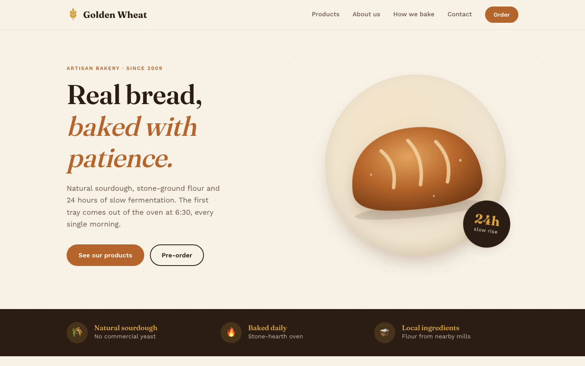
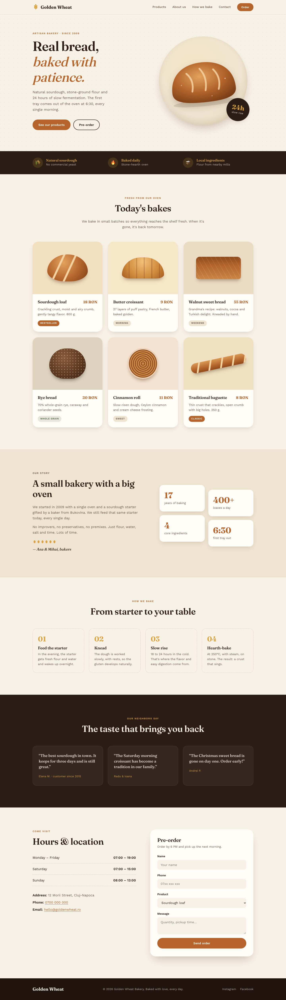
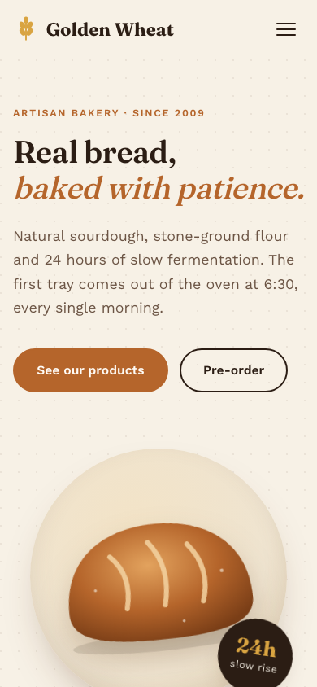

# Golden Wheat — Artisan Bakery Website

A responsive landing page for a fictional artisan bakery, built with **pure HTML and CSS**. No frameworks, no JavaScript and no images: every illustration is drawn with SVG and CSS.



## Features
- **Responsive layout:** 3 columns on desktop, 2 on tablet, 1 on mobile
- **CSS-only hamburger menu** on mobile (checkbox technique, no JavaScript)
- **Hand-drawn CSS/SVG illustrations** for the hero bread and all 6 products
- **Sticky header** with a blurred background
- **Pre-order form** with styled inputs and focus states
- **Accessibility:** semantic HTML, visible focus outlines, `prefers-reduced-motion` support
- **Design tokens** in CSS custom properties (colors, radii, shadows)

## Sections
Header · Hero · Perks · Products · About us · How we bake · Testimonials · Hours & contact · Footer

## Tech stack
- HTML5
- CSS3 (Grid, Flexbox, custom properties, `clamp()`, keyframe animations)
- Google Fonts: [Fraunces](https://fonts.google.com/specimen/Fraunces) and [Work Sans](https://fonts.google.com/specimen/Work+Sans)

## Project structure
```
├── index.html      # Page markup
├── style.css       # All styles
├── DESIGN.md       # Design system: palette, typography, layout
└── screenshots/    # Desktop and mobile previews
```

## Run locally
No build step needed. Clone the repo and open `index.html` in your browser:

```bash
git clone https://github.com/SergiuCalancea/bakery.git
cd bakery
open index.html   # macOS. On Windows, double-click the file.
```

## Screenshots

| Desktop | Mobile |
|---|---|
|  |  |

The full design system is documented in [DESIGN.md](DESIGN.md).

## Author
**Sergiu Calancea**: [GitHub](https://github.com/SergiuCalancea)
